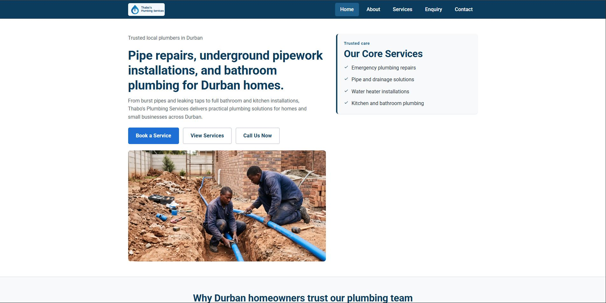
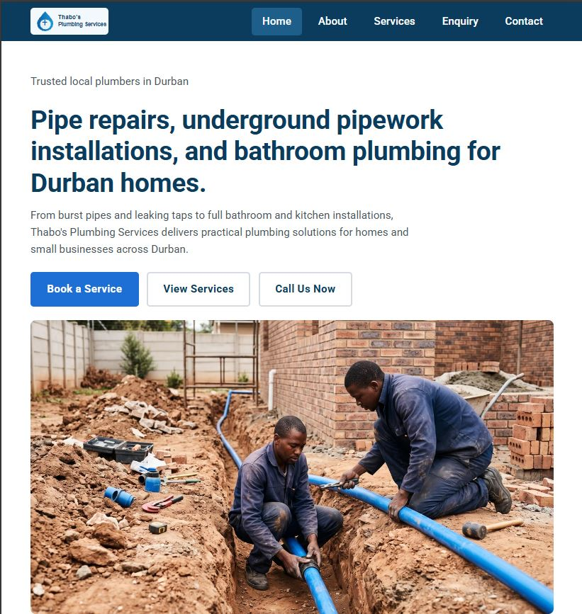
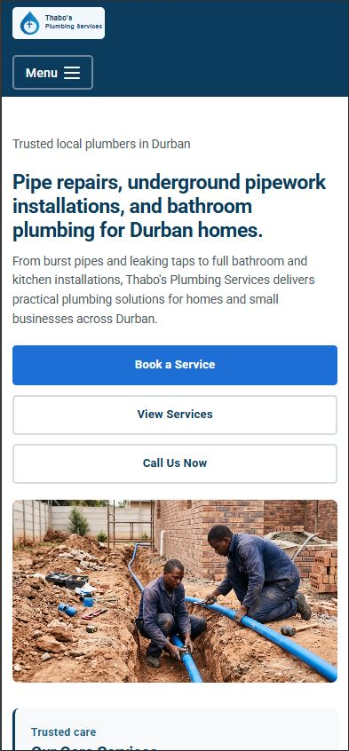

# Thabo's Plumbing Services: Web Application Documentation

| **Details** | **Information** |
|---|---|
| Student Name | Saravan Jeeth Naidoo |
| Student Number | ST10510632 |
| Course | Higher Certificate In Mobile Application And Web Development |
| Module | WEDE5020 |
| Lecturer | Hiren Thulasaie |
| Repository | [wede5020-g1-2026-summative-1-portfolio-of-evidence-saravvnaidoo](https://github.com/EMKNDW/wede5020-g1-2026-summative-1-portfolio-of-evidence-saravvnaidoo) |

---

## Table of Contents
- [Project Overview](#project-overview)
- [Target Audience](#target-audience)
- [1. Project Setup and Structure](#1-project-setup-and-structure)
- [2. CSS Styling (Desktop Solution)](#2-css-styling-desktop-solution)
- [3. Responsive Design](#3-responsive-design)
- [4. Accessibility and SEO](#4-accessibility-and-seo)
- [5. Design Iterations and Refinements](#5-design-iterations-and-refinements)
- [Budget](#budget)
- [Image Credits](#image-credits)
- [AI Use Statement](#ai-use-statement)
- [Part 2 Requirements Coverage](#part-2-requirements-coverage)
- [Changelog](#changelog)
- [References](#references)

---

## Project Overview
A multi-page responsive website built for **Thabo's Plumbing Services**, a small plumbing business in Durban, KwaZulu-Natal. The site gives homeowners and small businesses clear service details, the company story, contact locations, tap-to-call phone links and an enquiry form with client-side validation.

The colour scheme (blue and grey) and the typeface (Roboto) follow the design decisions in the Part 1 proposal. Blue and grey were chosen because they communicate trust and professionalism, which suits a trade business that customers invite into their homes (New Target, Inc., 2025; Chloe Leonard Studio, 2026). Roboto was chosen because it is clean and easy to read on a phone, where most customers are expected to find the site.

---

## Target Audience
The content research for this project identified two groups of visitors:

- **Primary audience:** homeowners and residential landlords in Durban and the surrounding KwaZulu-Natal areas who need emergency repairs or plumbing maintenance.
- **Secondary audience:** commercial building managers who want scheduled maintenance for office complexes.

Their main goals are to find contact details quickly, request a quote through an online form, and understand the services on offer and how pricing works. These goals shaped the site: the navigation is the same on every page, the "Book a Service" button is prominent on the home page, tap-to-call links on the home, enquiry and contact pages let a visitor phone with one tap, the enquiry form is one click away, and the layout is designed to be read on a phone first.

---

## 1. Project Setup and Structure
All project files sit in the **root of the repository** (as requested in the Part 1 feedback), with supporting files in clearly named subfolders:

```
/ (repository root)
├── index.html
├── about.html
├── services.html
├── enquiry.html
├── contact.html
├── README.md
├── css/
│   └── style.css
├── js/
│   └── main.js
└── images/
    ├── logo.svg
    ├── (site photographs and their resized copies)
    └── desktop.JPG, tablet.JPG, mobile.JPG  (testing screenshots)
```

- **External stylesheet:** one file, `css/style.css`, linked from the `<head>` of all five pages.
- **Naming convention:** lowercase file names (the screenshots use the `.JPG` extension) with no spaces, one stylesheet and one script file.
- **Multi-page architecture:** five HTML pages that share the same header, navigation and footer.

### Sitemap and page features
```
Home (index.html)
├── About (about.html)
├── Services (services.html)
├── Enquiry (enquiry.html)
└── Contact (contact.html)
```

| Page | What it offers the visitor |
|---|---|
| **Home** (`index.html`) | Hero with headline, short introduction and three buttons: "Book a Service", "View Services" and "Call Us Now" (a tap-to-call link); a "Core Services" highlights card; three "why choose us" cards (Experienced Team, Prompt Response, Transparent Pricing); and a small photo gallery. |
| **About** (`about.html`) | The business story, including that Thabo started the business in 2018 after six years at a larger plumbing company, the mission and vision, and the values the business stands for (Reliability, Quality, Customer Focus). |
| **Services** (`services.html`) | Six service cards with photos and descriptions: Pipe Repairs, Underground Pipework Installation (new water and drainage pipework for home extensions and outbuildings, connected to existing plumbing), Drain Clearing, Bathroom Plumbing, Kitchen Plumbing and General Maintenance; reasons to choose the business; and a section for small businesses and commercial properties with a "Request a Quote" button. |
| **Enquiry** (`enquiry.html`) | A booking/enquiry form (name, email, phone, service needed, message). `js/main.js` validates it and shows inline error and success messages. An "Is it urgent?" line gives a tap-to-call link for urgent jobs. |
| **Contact** (`contact.html`) | Address, phone and email for two locations (Durban Central and Umhlanga), a "Call Us" card with a tap-to-call link, a photo, and a direct message form with the browser's built-in `required` and email checks. |

**Planned and not yet built:** a phone number in the header of every page and an embedded map of the service areas.

### Hosting
The proposed hosting is a basic shared hosting plan with a `.co.za` domain. The costs, their sources and the reasoning are in the [Budget](#budget) section.

---

## 2. CSS Styling (Desktop Solution)
All styling is in `css/style.css`, organised into commented sections: design variables, reset and base styles, text, page layout, header and navigation, buttons, hero, cards and galleries, contact page and forms, footer, hover/focus/active states and responsive breakpoints.

### 2.1 External stylesheet
`css/style.css` is linked from every page with `<link rel="stylesheet" href="css/style.css" />`.

### 2.2 Base style and reset
- A reset (`margin: 0; padding: 0; box-sizing: border-box`) is applied to every element so browsers start from the same point.
- **CSS custom properties** in `:root` store the colour scheme, font stack, spacing scale, border radius and shadows. Changing one variable updates the whole site, which keeps the number of selectors low and makes use of the cascade (MDN Web Docs, n.d.f).
- Colour scheme: navy `#0b3c5d`, bright blue `#1d6fd6` for actions, and light greys for backgrounds and borders.

### 2.3 Typography
- Font: **Roboto** (Google Fonts) with the fallback stack `"Segoe UI", Arial, sans-serif` (Google Fonts, n.d.).
- A **1.25 modular type scale** is used for text sizes (1rem, 1.25rem, 1.563rem, 1.953rem, 2.441rem).
- `font-weight` (400/500/700), `line-height` (1.6 body, 1.2 headings) and `letter-spacing` (tighter on large headings, slightly wider on labels and buttons) are set deliberately.
- Paragraphs have a `max-width: 65ch` so lines stay comfortable to read.

### 2.4 Layout structure
- **CSS Grid** is used for the hero (with `grid-template-areas`), the card grid (`repeat(3, 1fr)`, so three or six cards always fill their rows), the photo gallery, the contact page and the form (MDN Web Docs, n.d.c).
- **Flexbox** is used for the header, navigation, footer, button groups and list items with icons (MDN Web Docs, n.d.b).

### 2.5 Visual styles and interaction
- `color`, `background-color`, `border`, `border-radius` and `box-shadow` style the cards, buttons, header and form panels.
- `:hover` states on links, buttons, cards and form fields.
- `:focus` and `:focus-visible` states give keyboard users a clear outline (MDN Web Docs, n.d.d).
- `:active` states give buttons a pressed effect.
- `:user-valid` and `:user-invalid` give form fields a green or red border after the visitor has filled in or left a field, so the form does not show errors before anyone has typed.
- `:last-child` removes the extra space under the last paragraph in a card and the last item in the highlights list.
- The mobile menu button has `:hover`, `:active` and `:focus-visible` states that match the navigation links.
- Phone links in the contact cards and the urgent-job note are underlined and change colour on `:hover`, so they are recognisable as links.

### 2.6 Technical requirements
- **HTML5** structures every page. Semantic elements such as `<header>`, `<nav>`, `<main>`, `<section>`, `<article>`, `<aside>` and `<footer>` describe the purpose of each block, which helps screen readers, search engines and other developers (MDN Web Docs, n.d.e). Phone numbers use `tel:` links so a phone can start a call with one tap.
- **CSS3** controls colours, typography and layout from one external stylesheet, so every page stays consistent, and media queries make the layout adapt to different screens.
- **JavaScript** (`js/main.js`) highlights the active navigation link, opens and closes the mobile menu, and validates the enquiry form in the browser so customers get immediate feedback on mistakes. Browser-side validation improves the experience but does not replace server-side checks (MDN Web Docs, n.d.a).

---

## 3. Responsive Design

### 3.1 Breakpoints
| Breakpoint | Media query | Changes |
|---|---|---|
| Desktop | default styles | Two-column hero, three-column card grid, horizontal navigation, side-by-side contact layout |
| Tablet | `max-width: 1024px` | Base font size reduced slightly, hero stacks (highlights card moves below the text), cards stay in three columns so no card sits alone on a second row |
| Mobile | `max-width: 768px` | Single-column layout everywhere, smaller headings, footer stacks, navigation collapses into a hamburger menu button that opens a two-column grid of large tap targets, buttons become full width |
| Small phone | `max-width: 480px` | Wider content area, gallery becomes one column, tighter card padding, smaller headings, body text, navigation links and buttons |

The layout switches from multiple columns on large screens to a single column on small screens. Font sizes are reduced at the tablet, mobile and small-phone breakpoints, and the navigation changes at the mobile breakpoint. The menu button is added by `js/main.js`, so if the script does not load, the links stay visible as a grid instead of being hidden (MDN Web Docs, n.d.g).

### 3.2 Relative units
Font sizes, padding, margins and gaps are written in `rem`/`em`, and widths use `%`, `fr` and `ch`, so the layout follows the user's font settings and screen width. Images use `aspect-ratio` instead of fixed pixel heights.

### 3.3 Images and media
- **Fluid images:** `max-width: 100%` and `height: auto` on all images, with `object-fit: cover` and `aspect-ratio` so photos crop neatly without distortion.
- **Responsive images:** every photo has resized 480px, 800px and 1200px copies. `srcset` and `sizes` tell the browser which file to download for the screen size, and the home page hero uses a `<picture>` element with a WebP source and a JPG fallback (MDN Web Docs, n.d.h).
- **Lazy loading:** `loading="lazy"` is used only on images below the fold (home page cards and gallery, about page gallery, and the last three service cards). The hero, about banner, contact photo and first row of service cards load immediately so the top of each page appears quickly. Images also have `width` and `height` attributes to reduce layout shift.
- **Alt text:** all images have descriptive `alt` text for screen readers and SEO, and it describes what each photo shows.

### 3.4 Testing and screenshot evidence
The site was tested with the Chrome DevTools device toolbar. Each screenshot below names the device and the width it was captured at. The tablet screenshot is taken at 820px, which sits inside the tablet range (769px to 1024px) and above the 768px mobile breakpoint, so it shows the tablet layout. An earlier tablet screenshot was 572px wide and showed the mobile layout, so it was replaced.

<div align="center">

### Desktop View



*Chrome DevTools, desktop, 1906px wide*

<br>
<hr>
<br>

### Tablet View



*Chrome DevTools, iPad Air, 820px wide*

<br>
<hr>
<br>

### Mobile View



*Chrome DevTools, iPhone 15, 390px wide*

</div>

---

## 4. Accessibility and SEO
- Semantic HTML5 elements on all pages, with one `<h1>` per page. The home, about and services pages use `<h2>` and `<h3>` headings for their sections. The contact and enquiry pages still need `<h2>` headings, which is planned for the SEO work in Part 3.
- Every form `<label>` is linked to its input with `for` and `id`, and HTML5 validation attributes (`required`, `pattern`, `type`) are used.
- Each page has its own `<title>` and `<meta name="description">`.
- Visible focus outlines for keyboard users (`:focus-visible`).
- The mobile menu button is a real `<button>` with `aria-expanded` and `aria-controls`, so screen readers announce whether the menu is open or closed.
- Large tap targets for navigation and buttons on mobile, and tap-to-call links so visitors on a phone do not have to type a number.
- `prefers-reduced-motion` is respected: transitions and hover movement are switched off for users who request it.

---

## 5. Design Iterations and Refinements
- **Content first:** the "Book a Service" and enquiry buttons stay prominent at every screen size, and the hero text comes before the highlights card on small screens.
- **Simplicity:** one typeface, a limited blue and grey palette and consistent spacing from the CSS variables keep pages uncluttered.
- **Testing and iteration:** after testing in the developer tools, the navigation was changed from wrapping links to a grid of larger tap targets and then to a hamburger menu on mobile, the tablet card grid was changed from two columns to three so no card sits alone, and fixed pixel image heights were replaced with `aspect-ratio` so photos scale with their containers.
- **Content from the research:** the research showed that visitors want to find a contact number quickly, so tap-to-call links were added to the home, enquiry and contact pages. A section for small businesses and commercial properties, and an underground pipework service for extensions and outbuildings, were added to the services page.

---

## Budget
This budget replaces the single average used in the Part 1 proposal. It is built for this specific website: a five-page static site with no database, no online shop and no user accounts, so an entry-level shared hosting plan is enough. Prices are indicative and were checked on 4 October 2026.

| Item | Basis and source | Low (R/year) | Expected (R/year) |
|---|---|---|---|
| `.co.za` domain | Three South African registrars charge R70, R75 and R197 a year, an average of R107.33 (Truehost, 2024). | R70 | R107 |
| Shared hosting (entry plan) | Entry plans cost R35 to R89 a month, and the average is R69.33 a month (Truehost, 2024). Entry plans start from R35 a month (ProCompare, n.d.). | R420 (R35 × 12) | R832 (R69.33 × 12) |
| SSL certificate (secure padlock) | Included free with the Truehost hosting plans (Truehost, 2024). | R0 | R0 |
| **Domain and hosting subtotal** | | **R490** | **R939** |
| Maintenance and small updates | Basic maintenance retainers for small static informational websites cost R199 to R500 a month (ProCompare, n.d.). The expected figure uses R250 a month, as in the Part 1 proposal. | R2,388 (R199 × 12) | R3,000 (R250 × 12) |
| **Estimated yearly running cost** | | **R2,878** | **R3,939** |

**Notes**
- Truehost (2024) quotes about R901 a year for a domain plus hosting. The expected subtotal above is slightly higher (R939) because it multiplies the average monthly hosting price by 12.
- The Part 1 proposal estimated about R850 a year for domain and hosting and R250 a month for maintenance. The new figures are now sourced and the maintenance estimate sits inside the published range.
- **Photographs:** the stock photographs on this site are used for the coursework and credited in [Image Credits](#image-credits). For a live launch, Thabo should use his own photos of completed jobs (no cost) or buy licences, so no licence cost is included here.
- **Enquiry form:** the form currently checks input in the browser only. Sending enquiries to Thabo's email needs a form handler, which is planned for a later part and is not included in this budget.
- **Build cost:** the website was built as coursework, so no developer fee is included.

---

## Image Credits
The photographs listed below are AI-generated images created with Google Gemini on 31 October 2026 and used for this coursework. The conversation used to generate them is at [Gemini chat](https://share.gemini.google/YHfzgqyoMhAw), and the exact prompts for each image are listed in [References](#references).

| Photograph | Where it is used | Credit |
|---|---|---|
| A plumber fitting new pipework in a trench beside a house | Home page hero | Gemini AI, 31 Oct 2026 |
| A plumber repairing outdoor pipework beside a house | Home page; Services (Pipe Repairs) | Gemini AI, 31 Oct 2026 |
| Two plumbers laying pipework beside a home extension | Services (Underground Pipework Installation) | Gemini AI, 31 Oct 2026 |
| A plumber working beneath a kitchen sink | Home page | Gemini AI, 31 Oct 2026 |
| A plumber connecting pipes under a kitchen sink | Services (Kitchen Plumbing) | Gemini AI, 31 Oct 2026 |
| A plumber checking pipes and a pressure gauge | About page; Services (General Maintenance) | Gemini AI, 31 Oct 2026 |
| A plumber shaking hands with a homeowner | Home page; About page | Gemini AI, 31 Oct 2026 |
| A close-up of a plumber cutting copper pipe | Home page; About page gallery | Gemini AI, 31 Oct 2026 |
| `bathroom-plumbing.jpg`: A plumber fitting a new tap on a white bathroom basin | Contact page; Services (Bathroom Plumbing) | Gemini AI, 31 Oct 2026 |
| A plumber clearing a blocked outdoor drain | Services (Drain Clearing) | Gemini AI, 31 Oct 2026 |
---

## AI Use Statement
I used AI tools while working on this project. Google Gemini generated the photographs on the site (see [Image Credits](#image-credits) and [References](#references)). An AI assistant (Claude, by Anthropic) and a coding agent helped me plan the work, draft code and documentation, and review my feedback. I tested the website myself and I am responsible for the final content of this submission.

---

## Part 2 Requirements Coverage
This table shows where each item in the Part 2 brief is covered in this README and in the website.

| Brief item | Where it is covered | Summary |
|---|---|---|
| 1. Feedback from Part 1 | [Changelog, table A](#a-part-1-feedback) | Each lecturer comment is listed with the change made and its status. |
| 2.1 External stylesheet | [Section 2.1](#21-external-stylesheet) | `css/style.css` is linked from all five pages. |
| 2.2 Base style | [Section 2.2](#22-base-style-and-reset) | Reset, `:root` variables, base font, size and colour scheme. |
| 2.3 Typography | [Section 2.3](#23-typography) | Roboto, a 1.25 type scale, weights, line height and letter spacing. |
| 2.4 Layout | [Section 2.4](#24-layout-structure) | CSS Grid (including `grid-template-areas`) and Flexbox. |
| 2.5 Visual styles | [Section 2.5](#25-visual-styles-and-interaction) | Colour, borders, shadows, `:hover`, `:focus`, `:active` and more. |
| 3.1 Breakpoints | [Section 3.1](#31-breakpoints) | Tablet, mobile and small-phone breakpoints, with layout, font and navigation changes. |
| 3.2 Relative units | [Section 3.2](#32-relative-units) | `rem`, `em`, `%`, `fr` and `ch`. |
| 3.3 Responsive images | [Section 3.3](#33-images-and-media) | `srcset`, `sizes`, `<picture>` and lazy loading. |
| 3.4 Test and iterate | [Section 3.4](#34-testing-and-screenshot-evidence) | DevTools screenshots for desktop, tablet and mobile. |
| 4. GitHub | [Changelog, table B](#b-part-2-changes-css-styling-and-responsive-design) and [References](#references) | Dated changelog entries for every change, and a full reference list. |

---

## Changelog

The detailed changelog tables are maintained in [CHANGELOG.md](CHANGELOG.md).

## References

Gemini (2026) *AI-generated underground pipework photograph* [AI-generated image]. Prompt: "Two plumbers laying blue water pipes in a trench at the side of a home extension, new bricks in the background. Realistic photograph, natural daylight, shallow depth of field, 3:2 landscape, no text, no logos, no watermark, South African home setting." Google Gemini. Available at: https://share.gemini.google/YHfzgqyoMhAw (Generated: 31 October 2026).

Gemini (2026) *AI-generated under-sink repair photograph* [AI-generated image]. Prompt: "A plumber kneeling under a kitchen sink, tightening a pipe fitting with a wrench, a bucket beside him. Realistic photograph, natural daylight, shallow depth of field, 3:2 landscape, no text, no logos, no watermark, South African home setting." Google Gemini. Available at: https://share.gemini.google/YHfzgqyoMhAw (Generated: 31 October 2026).

Gemini (2026) *AI-generated outside pipe repair photograph* [AI-generated image]. Prompt: "A plumber in a navy work shirt fitting new grey PVC pipework in a trench in red soil beside a house, tools on the ground. Realistic photograph, natural daylight, shallow depth of field, 3:2 landscape, no text, no logos, no watermark, South African home setting." Google Gemini. Available at: https://share.gemini.google/YHfzgqyoMhAw (Generated: 31 October 2026).

Gemini (2026) *AI-generated maintenance photograph* [AI-generated image]. Prompt: "A plumber checking pipe joints and a pressure gauge on a household water system in a utility room. Realistic photograph, natural daylight, shallow depth of field, 3:2 landscape, no text, no logos, no watermark, South African home setting." Google Gemini. Available at: https://share.gemini.google/YHfzgqyoMhAw (Generated: 31 October 2026).

Gemini (2026) *AI-generated kitchen plumbing photograph* [AI-generated image]. Prompt: "A plumber connecting the waste pipe under a modern kitchen sink, cupboard doors open. Realistic photograph, natural daylight, shallow depth of field, 3:2 landscape, no text, no logos, no watermark, South African home setting." Google Gemini. Available at: https://share.gemini.google/YHfzgqyoMhAw (Generated: 31 October 2026).

Gemini (2026) *AI-generated copper pipe cutting photograph* [AI-generated image]. Prompt: "A close-up of a plumber's hands using a pipe cutter on a copper pipe, tools laid out on a workbench. Realistic photograph, natural daylight, shallow depth of field, 3:2 landscape, no text, no logos, no watermark, South African home setting." Google Gemini. Available at: https://share.gemini.google/YHfzgqyoMhAw (Generated: 31 October 2026).

Gemini (2026) *AI-generated customer and plumber photograph* [AI-generated image]. Prompt: "A friendly plumber in uniform shaking hands with a homeowner at the front door, toolbag at his feet. Realistic photograph, natural daylight, shallow depth of field, 3:2 landscape, no text, no logos, no watermark, South African home setting." Google Gemini. Available at: https://share.gemini.google/YHfzgqyoMhAw (Generated: 31 October 2026).

Gemini (2026) *AI-generated bathroom plumbing photograph* [AI-generated image]. Prompt: "A plumber fitting a new tap on a white bathroom basin in a clean half-renovated bathroom, tiles on the wall behind him and plumbing tools laid out on the floor beside him. Realistic photograph, natural daylight, shallow depth of field, 3:2 landscape, no text, no logos, no watermark, South African home setting." Google Gemini. Available at: https://share.gemini.google/YHfzgqyoMhAw (Generated: 31 October 2026).

Gemini (2026) *AI-generated drain clearing photograph* [AI-generated image]. Prompt: "A plumber in a navy work shirt clearing a blocked drain outside a South African home, feeding a drain rod into an open inspection cover, a bucket and drain rods on the ground beside him. Realistic photograph, natural daylight, shallow depth of field, 3:2 landscape, no text, no logos, no watermark." Google Gemini. Available at: https://share.gemini.google/YHfzgqyoMhAw (Generated: 31 October 2026).

Anthropic (2026) *Claude* [Large language model]. Available at: https://claude.ai (Accessed: 31 October 2026).

Chloe Leonard Studio (2026) *Color Psychology in Web Design: How to Use Color to Influence Users*. Available at: https://www.chloeleonard.com/blog/colorpsychology-in-web-design (Accessed: 1 October 2026).

Google Fonts (n.d.) *Roboto*. Available at: https://fonts.google.com/specimen/Roboto (Accessed: 1 October 2026).

MDN Web Docs (n.d.a) *Client-side form validation*. Available at: https://developer.mozilla.org/en-US/docs/Learn_web_development/Extensions/Forms/Form_validation (Accessed: 1 October 2026).

MDN Web Docs (n.d.b) *CSS flexible box layout*. Available at: https://developer.mozilla.org/en-US/docs/Web/CSS/CSS_flexible_box_layout (Accessed: 1 October 2026).

MDN Web Docs (n.d.c) *CSS grid layout*. Available at: https://developer.mozilla.org/en-US/docs/Web/CSS/CSS_grid_layout (Accessed: 1 October 2026).

MDN Web Docs (n.d.d) *:focus-visible*. Available at: https://developer.mozilla.org/en-US/docs/Web/CSS/:focus-visible (Accessed: 1 October 2026).

MDN Web Docs (n.d.e) *HTML elements reference*. Available at: https://developer.mozilla.org/en-US/docs/Web/HTML/Element (Accessed: 1 October 2026).

MDN Web Docs (n.d.f) *Using CSS custom properties (variables)*. Available at: https://developer.mozilla.org/en-US/docs/Web/CSS/Using_CSS_custom_properties (Accessed: 1 October 2026).

MDN Web Docs (n.d.g) *Using media queries*. Available at: https://developer.mozilla.org/en-US/docs/Web/CSS/CSS_media_queries/Using_media_queries (Accessed: 1 October 2026).

MDN Web Docs (n.d.h) *Responsive images*. Available at: https://developer.mozilla.org/en-US/docs/Web/HTML/Guides/Responsive_images (Accessed: 1 October 2026).

New Target, Inc. (2025) *Color Psychology in Website Design*. Available at: https://www.newtarget.com/web-insights-blog/color-psychology-in-website-design/ (Accessed: 30 August 2026).

ProCompare (n.d.) *Beyond the build: a 3-year forecast of your website's true running costs in South Africa*. Available at: https://www.procompare.co.za/articles/digital-marketing-seo-services/website-running-costs (Accessed: 4 October 2026).

Truehost (2024) *Guide To Cost Of Hosting A Website In South Africa*. Available at: https://truehost.co.za/cost-of-hosting-website-south-africa/ (Accessed: 4 October 2026).
